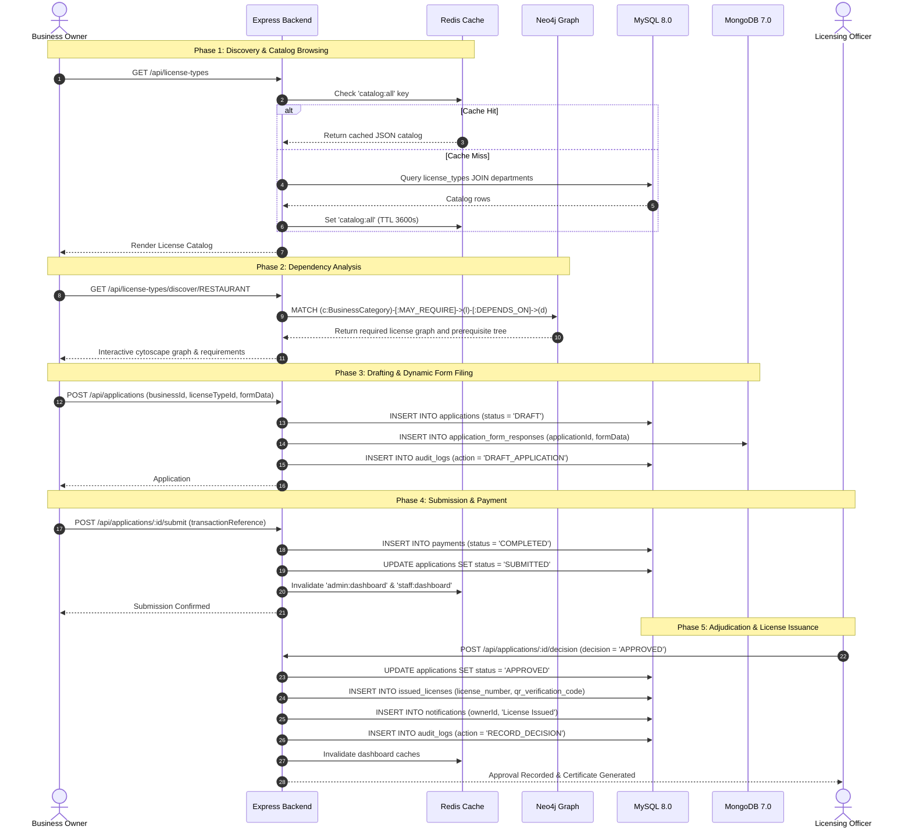

# BizPermit — System Architecture & Multi-Database Design

BizPermit (Smart Business License Management System) is an enterprise full-stack web application demonstrating an academic **Polyglot Persistence Architecture**. Rather than forcing all application data into a single database paradigm, the system decomposes data storage across four distinct database engines matching their natural theoretical strengths.

---

## 1. High-Level Architectural Diagram

```
+-----------------------------------------------------------------------------------+
|                            CLIENT PRESENTATION TIER                               |
|   HTML5 + Vanilla CSS3 (Custom Design System) + Vanilla JS (ES6+ Native Fetch)    |
|   Role Spaces: Public Catalog | Business Owner | Licensing Officer | Admin        |
+-----------------------------------------------------------------------------------+
                                          |
                                   HTTP / REST JSON
                                          v
+-----------------------------------------------------------------------------------+
|                        APPLICATION SERVER (NODE.JS / EXPRESS)                     |
|  - Auth Middleware (JWT / Cookie Session)                                          |
|  - Role-Based Access Control (RBAC: OWNER, OFFICER, INSPECTOR, ADMIN)             |
|  - Repository Layer (Data abstraction for polyglot engines)                       |
|  - Service Orchestration Layer                                                    |
+-----------------------------------------------------------------------------------+
       |                     |                        |                     |
       v                     v                        v                     v
+--------------+     +---------------+        +--------------+      +---------------+
|    MySQL     |     |    MongoDB    |        |    Neo4j     |      |     Redis     |
|  Relational  |     |   Document    |        |    Graph     |      |   In-Memory   |
+--------------+     +---------------+        +--------------+      +---------------+
| - Identity   |     | - Flexible    |        | - Dependency |      | - Catalog     |
| - RBAC       |     |   Form Specs  |        |   Chains     |        Cache         |
| - State Mach |     | - Audit Check |        | - Prereq     |      | - Dashboard   |
| - Payments   |     |   Lists       |        |   Graph      |        Metrics       |
| - Ledger     |     | - Geo/Photos  |        | - Sector     |      | - Session &   |
| - Audit Logs |     |   Metadata    |        |   Discovery  |        Token Guard   |
+--------------+     +---------------+        +--------------+      +---------------+
```

---

## 2. Multi-Model Database Integration Rationale

| Database | Model Type | Core Responsibilities in BizPermit | Why This Engine Was Chosen |
|---|---|---|---|
| **MySQL 8.0** | Relational / ACID RDBMS | Users, Credentials, Businesses, Application Status State-Machine, Payments, Issued Licenses, Audit Logs | Strict referential integrity, foreign key constraints, atomic transactions for financial and permit issuance states. |
| **MongoDB 7.0** | Document / JSON BSON | `application_form_responses` (Dynamic sector forms), `inspection_reports` (Itemized field audit checklists) | Different license types demand completely different form fields (e.g. cold storage KVA vs. software IP compliance). Documents avoid sparse, wide SQL tables. |
| **Neo4j 5.20** | Graph / Labeled Property Graph | License prerequisite trees (`DEPENDS_ON`), sector eligibility (`MAY_REQUIRE`), departmental routing (`HANDLED_BY`) | Graph traversal queries allow resolving recursive prerequisite chains without costly recursive common table expressions (CTEs) in SQL. |
| **Redis 7.2** | Key-Value In-Memory Cache | License Catalog caching (`catalog:all`), Admin & Staff Dashboard aggregated metrics, session tokens | Sub-millisecond reads for heavily queried public catalogs; offloads heavy GROUP-BY calculations from the transactional MySQL database. |

---

## 3. Polyglot Lifecycle Workflow

The lifecycle of a single license application traverses all four database tiers:



---

## 4. Security & Role-Based Access Control (RBAC)

1. **Authentication:**
   - Password hashing via **bcryptjs** (cost factor 10).
   - Session tokens or JWTs checked per request via `authenticate` middleware.
   - User roles cached in request context (`req.user = { id, email, roles: [...] }`).

2. **Authorization Guards:**
   - `requireAuth(role)` client-side guard redirects unauthorized sessions to `/login.html`.
   - `authorizeRoles('ADMIN', 'OFFICER')` backend route middleware rejects unauthorized attempts with HTTP 403 Forbidden.

3. **Audit Immutability:**
   - Every state change (login, review note, inspection scheduling, license grant, role modification) triggers an append-only insert into `audit_logs` in MySQL with IP address, timestamp, and JSON metadata.

---

## 5. Cache Invalidation & Event Sync Policies

- **License Catalog:** Modifying or adding a license type (`POST /api/admin/license-types`) automatically calls:
  1. `neo4jService.syncLicenseType(license)` -> Synchronizes Neo4j node properties and relationships.
  2. `redisService.invalidateAllLicenseCaches()` -> Deletes `catalog:all` and `catalog:license:*`.
- **Workflow State Changes:** Submitting, reviewing, or scheduling an audit invalidates `redisService.invalidateWorkflowCaches()`, ensuring administrator and staff dashboards immediately display updated workload counts.
