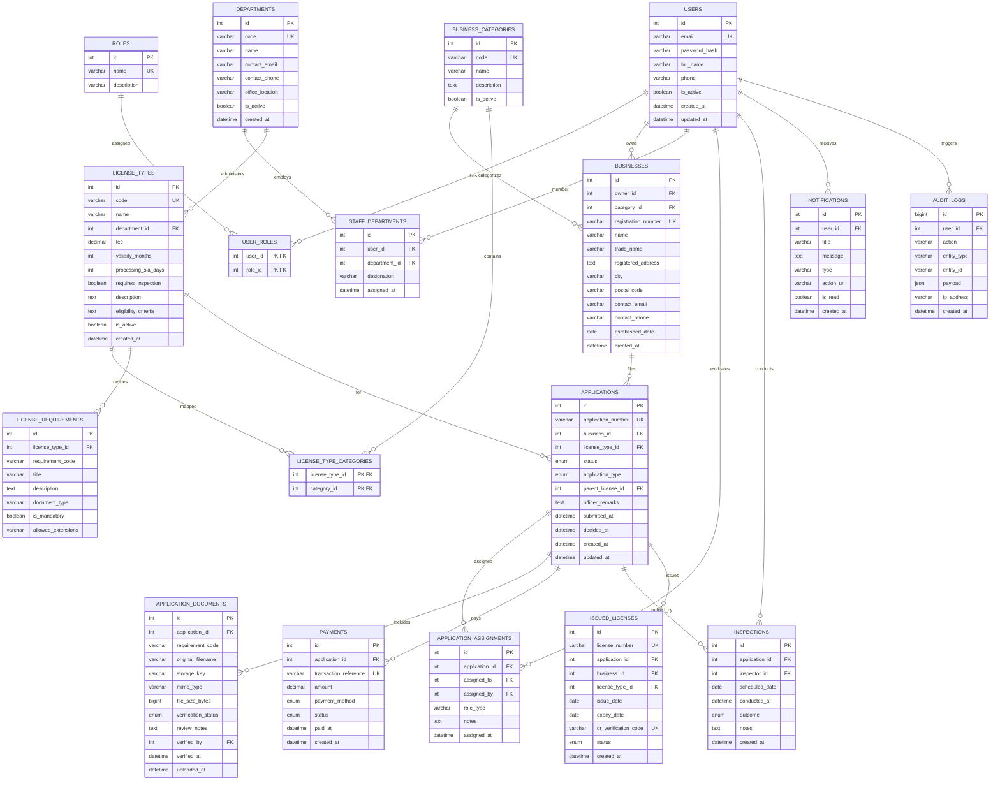

# BizPermit — Entity Relationship (ER) & Multi-Model Database Schema

BizPermit incorporates a **4-way Multi-Model Database Architecture** engineered for optimal academic DBMS rigor:
- **MySQL 8.0**: Relational source of truth for ACID transactions, role-based identity, application status machine, audit logs, and accounting.
- **MongoDB 7.0**: Flexible JSON document store for heterogeneous form submissions (`application_form_responses`) and multi-point audit checklists with GPS/evidence metadata (`inspection_reports`).
- **Neo4j 5.20**: Graph database for hierarchical license prerequisites, cross-department dependencies (`DEPENDS_ON`), and sector discovery (`MAY_REQUIRE`).
- **Redis 7.2**: High-throughput in-memory cache for catalog queries, session state verification, and dashboard metric acceleration.

---

## 1. Relational ER Diagram (MySQL)



---

## 2. Polyglot Multi-Database Schema Mapping

### A. MongoDB Document Collections

MongoDB handles schema-free polymorphic documents where requirements differ drastically between sectors (e.g., cold storage temperature logs vs. software export certificates).

#### 1. `application_form_responses`
- **Key Ref**: `applicationId: Integer` (indexed, maps to MySQL `applications.id`)
- **Schema**:
```json
{
  "_id": "ObjectId('67c1e5a...')",
  "applicationId": 14,
  "businessId": 2,
  "formData": {
    "proposedCapacityKVA": 450,
    "hazardousMaterialClassification": "CLASS_B",
    "shiftOperations": ["MORNING", "NIGHT"],
    "effluentDischargeLitersPerDay": 12000,
    "zoningClearanceId": "ZN-2026-9921"
  },
  "submittedAt": "2026-10-30T14:32:00.000Z",
  "version": 1
}
```

#### 2. `inspection_reports`
- **Key Ref**: `inspectionId: Integer` (indexed, maps to MySQL `inspections.id`)
- **Schema**:
```json
{
  "_id": "ObjectId('67c1e8b...')",
  "inspectionId": 5,
  "applicationId": 14,
  "inspectorId": 3,
  "checklist": [
    {
      "itemId": "INSP-01",
      "title": "Premises Structural & Life Safety Verification",
      "status": "PASS",
      "remarks": "Load bearing columns intact. Clearance certified."
    },
    {
      "itemId": "INSP-02",
      "title": "Emergency Egress & Exit Route Clearance",
      "status": "PASS",
      "remarks": "Illuminated signs functional, doors push-bar equipped."
    },
    {
      "itemId": "INSP-03",
      "title": "Fire Extinguisher & First-Aid Provision",
      "status": "PASS",
      "remarks": "10 ABC dry powder cylinders inspected. Hydrant pressurized."
    }
  ],
  "evidenceMetadata": [
    {
      "type": "PHOTO",
      "caption": "Main entry hydrant pressure gauge",
      "filename": "hydrant_gauge_verified.jpg",
      "timestamp": "2026-10-30T15:10:00.000Z"
    }
  ],
  "remarks": "Facility complies fully with municipal safety code.",
  "completedAt": "2026-10-30T15:15:22.000Z"
}
```

---

### B. Neo4j Graph Model

The Neo4j graph models municipal regulatory relationships that would cause expensive recursive joins in SQL:

```mermaid
graph TD
    BC[BusinessCategory] -->|MAY_REQUIRE| LT[LicenseType]
    LT -->|HANDLED_BY| D[Department]
    LT -->|DEPENDS_ON| DEP[LicenseType (Prerequisite)]
    LT -->|NEEDS_DOCUMENT| DT[DocumentType]

    style BC fill:#7c3aed,stroke:#fff,color:#fff
    style LT fill:#006B61,stroke:#fff,color:#fff
    style D fill:#2563eb,stroke:#fff,color:#fff
    style DEP fill:#ef4444,stroke:#fff,color:#fff
    style DT fill:#059669,stroke:#fff,color:#fff
```

**Cypher Query Example (Dependency Resolution):**
```cypher
MATCH (target:LicenseType {code: "FSSAI-R2"})
MATCH (target)-[:DEPENDS_ON*1..3]->(prereq:LicenseType)
RETURN prereq.code, prereq.name;
```

---

### C. Redis Key-Value Architecture

Redis accelerates read-intensive endpoints and maintains distributed caches:

| Key Pattern | Data Structure | TTL | Purpose |
|-------------|----------------|-----|---------|
| `catalog:all` | JSON String | 1 Hour | Cached list of all active license types |
| `catalog:license:<id>` | JSON String | 1 Hour | Single license specification with requirements |
| `admin:dashboard` | JSON String | 5 Minutes | Aggregated metrics, queue counts, and monthly volumes |
| `cache:auth:<tokenHash>` | Hash | 24 Hours | Session token invalidation & user payload caching |
| `rate:limit:<ip>` | String / Counter | 1 Minute | Brute-force and API throttling protection |
